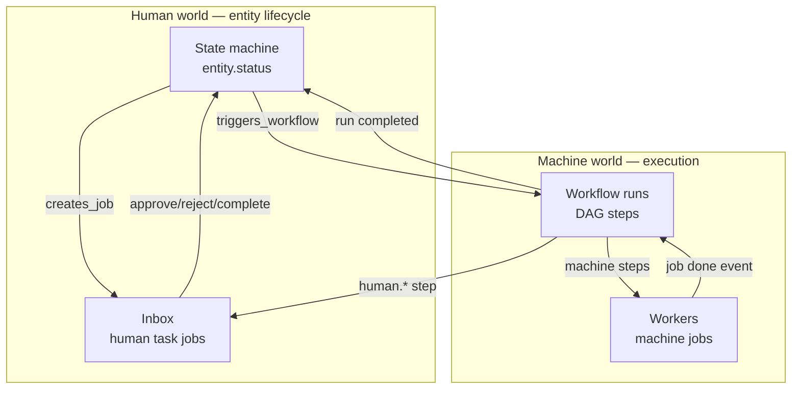
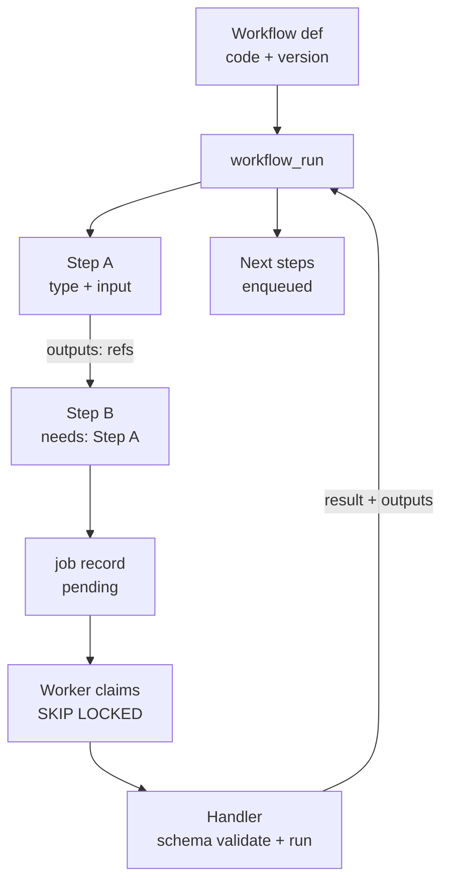
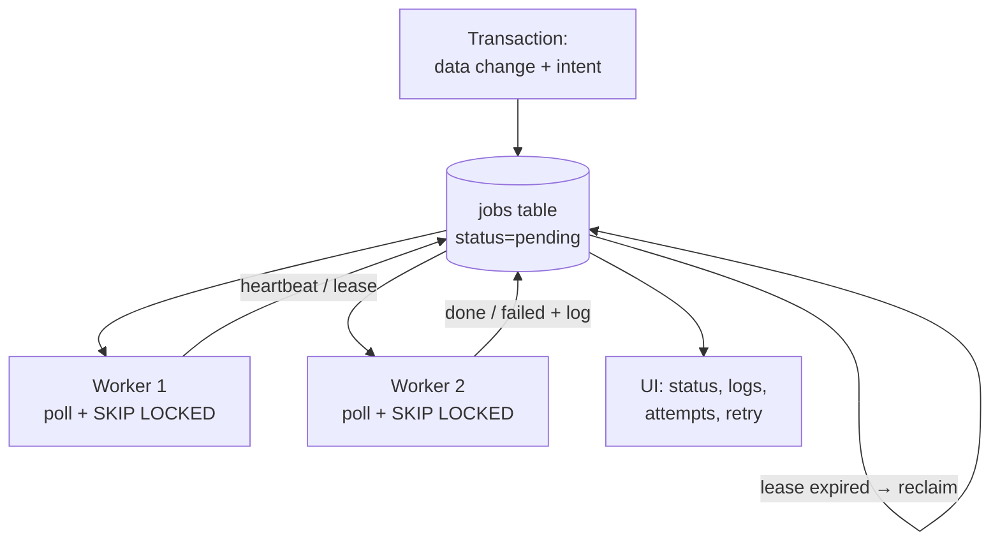
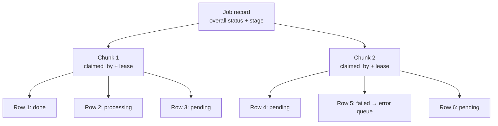
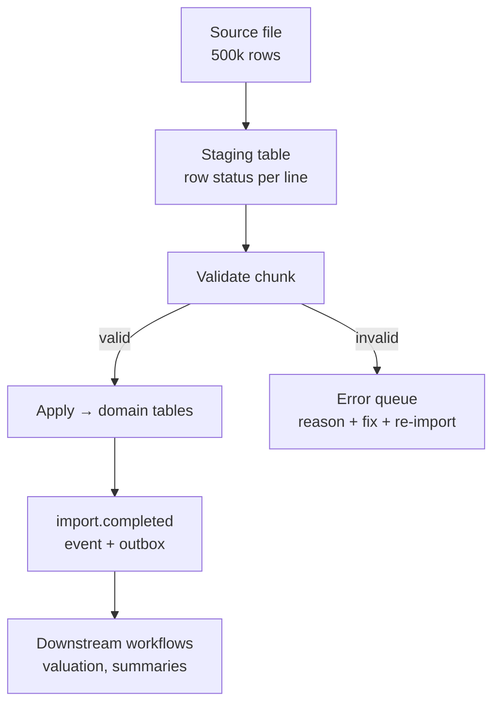
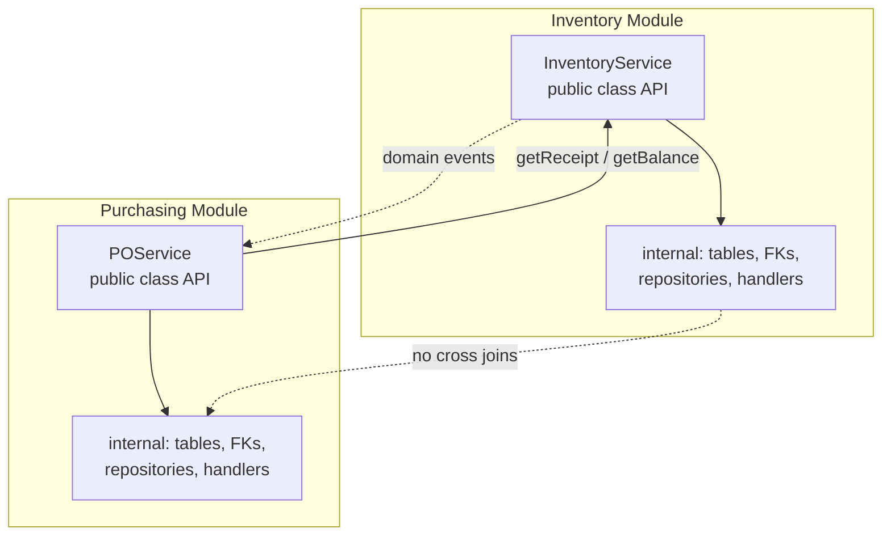
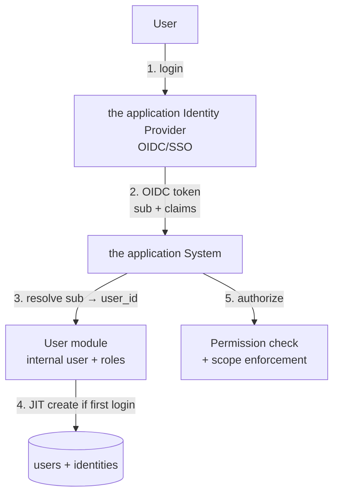
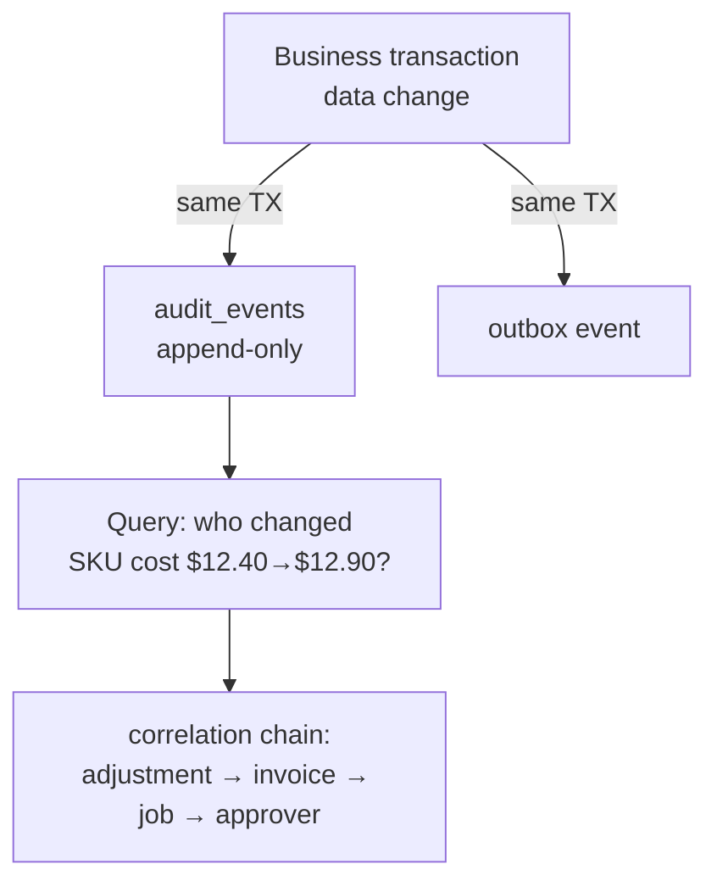

# Architecture Design Brief: keelflow

**Date:** 2026-11-17 \
**Project:** keelflow — reusable workflow engine
**Maintainer:** keelflow maintainers
**Status:** Draft for technical review \
**Related:** `docs/plans/completed/execution-plan.md`

> **Naming note (2026-11-19):** the engine originally called `hd-flow`
> (and scaffolded as `pyerp`) is published as **`keelflow`** — the
> language-agnostic contract lives in `spec/` (“keelflow spec”).
> Mentions of `hd-flow`/`pyerp` elsewhere in this brief refer to the
> same engine.

---

## 1. Purpose

This brief records the agreed technical direction for the keelflow platform foundations: the workflow/job engine, bulk processing, module isolation, model extension, authentication, authorization, and audit. It is the reference for the prototype in Phase 1 and for the technical design review gate.

### 1.1 The unified execution model

The platform is not "a workflow engine" — it coordinates three kinds of work that an ERP needs, all on the same durable Postgres state:



| Kind of work | Mechanism | Who acts |
|---|---|---|
| Entity lifecycle (approve/reject/resubmit) | State machine (`status` + transitions) | People, through UI actions |
| Waiting-for-a-person steps | Human task jobs in the same `jobs` table, surfaced via Inbox | People, through Inbox |
| Automated processing | DAG workflow runs claimed by workers | Machine |

Every transition between the two worlds is a durable record — job, transition, audit event — so the system always knows "who is it waiting on" at any moment: a worker, a named user, or a role queue.

The guiding principles throughout:

- **Durability before delivery** — work intent is committed to the database in the same transaction as the data change that created it. No dual-write, no lost triggers.
- **Pull-based execution** — workers claim work (like GitLab/GitHub Actions runners); the system never depends on pushing work to a runner.
- **Code-defined extensibility** — models, workflows, and permissions are defined in versioned code/config, not in a UI designer.
- **Single source of truth** — PostgreSQL holds business state, job state, and event intent.

## 2. Job and Workflow Engine

### 2.1 Model

The engine borrows the mental model of CI/CD pipelines (GitHub Actions, GitLab CI) and extends it for durable business data:



```text
workflow definition (code)  →  workflow_run  →  steps (DAG via `needs`)
step execution              →  job record    →  claimed by worker
worker execution            →  handler for job type
handler result              →  step outputs (references) + next steps enqueued
```

| Concept | Description |
|---|---|
| Workflow | Code-defined DAG of steps. Versioned (`user.onboarding@v1`). |
| Step | `{ id, type, input, needs[], if? }`. Runs only when its `needs` steps are complete. |
| Job | One execution of a step: `{ id, type, payload, status, attempts, lease }`. |
| Job type | Namespaced string `domain.action@vN` (e.g. `invoice.match@v1`, like `actions/checkout@v4`). |
| Handler | Code registered per job type. Validates payload against schema, executes, returns result. |
| Step outputs | Small reference values (`user_id`, `import_id`) stored durably; downstream steps load entities from the database by ID — never pass object snapshots. |

Dependencies stay intentionally shallow (`validate → apply → reconcile`). Conditional logic lives in handlers first; step-level `if:` guards handle "should this step run"; structurally different flows become separate workflow definitions rather than one definition full of branches.

### 2.2 Execution and state

All runtime state is durable in PostgreSQL — never in worker memory:

- **Job intent** is written in the same transaction as the triggering data change (transactional outbox). If the data commits, the intent exists; a crash cannot lose a trigger.
- **Workers poll** `SELECT ... FOR UPDATE SKIP LOCKED` to claim pending jobs. `LISTEN/NOTIFY` may reduce latency; polling remains the fallback. No dispatcher service is required — adding a worker is adding capacity.
- **Heartbeat/lease**: running workers renew a lease. A reaper (or the claim query) returns expired claims to `pending`, so a dead worker cannot lock work forever.
- **Scheduled work** is just a `run_at` timestamp on the job record; a lightweight scheduler writes intent, the same pull mechanism executes it.
- **Idempotency**: every handler is safe to re-run (idempotency keys / upserts). Delivery is at-least-once; correctness comes from idempotent processing.



For future remote workers (outside the network, different language, or no DB access), the claim/heartbeat/complete/report contract is designed as a clean internal service interface from day one, so a thin HTTP API can be placed in front of the same job tables later. Workers on the same infrastructure talk to the database directly — no network hop is added without need.

### 2.3 Handler registry

```text
registry.register(
    type    = "invoice.match@v1",
    input_schema  = InvoiceMatchPayload,
    output_schema = { matched: int, variance: decimal },
    handler = InvoiceMatchHandler,
)
```

- Payloads are validated at **enqueue time** (fail fast — no garbage in the queue) and again at **execution time** (jobs may have been written by older code).
- Schema validates shape only; business rules ("does this SKU exist") belong to the handler/domain.
- Versioned types let old jobs replay under the handler version that wrote them.
- Job payloads carry references (`import_id`, `chunk_range`), never bulk data.

### 2.4 Build vs adopt

The engine is packaged as a reusable library (`hd-flow`), but the commodity internals are adopted rather than rebuilt:

| Layer | Our design needs | Adopt or build |
|---|---|---|
| Job lifecycle | claim, retry, cancel, scheduling, rate limits | **Adopt** — Chancy or PgQueuer kernel (§10 #2) |
| Transactional intent | outbox record in the app's transaction | **Build thin layer** (or Procrastinate defer-in-transaction) |
| Workflow DAG | `needs`, `if:` guards, step outputs, versioned definitions | **Build** — our differentiator |
| Bulk chunking | chunk + per-row status + staging + error queue | **Build** — no existing library provides this |
| Handler registry | `type@vN` + input/output schema validation | **Build** |
| YAML workflow compiler | text definitions → DAG model | **Build** |
| Domain modules | inventory, FIFO, invoicing, RBAC, audit | **Build** — business logic |

### 2.5 hd-flow vs existing libraries

| Capability | **hd-flow (ours)** | Chancy | PgQueuer | Procrastinate | DBOS Transact | pgflow |
|---|---|---|---|---|---|---|
| Job queue on Postgres | ✓ | ✓ | ✓ | ✓ | ✓ (checkpoint DB) | ✓ |
| SKIP LOCKED claim | ✓ | ✓ | ✓ | ✓ | internal | ✓ |
| Transactional enqueue (outbox) | ✓ | partial | partial | **✓ native defer-in-TX** | via steps | — |
| Workflow DAG (`needs`/`if:`/outputs) | ✓ code-defined YAML | DAG via code, no YAML/guards | — | — | code functions, replay-model | ✓ SQL state machine |
| Handler registry `type@vN` + schemas | ✓ | — | — | — | — | — |
| Chunk + per-row state + staging | ✓ | — | — | — | — | — |
| Per-row error queue | ✓ | — | — | — | — | — |
| Job context (actor, via, permissions) | ✓ | — | — | — | — | — |
| RBAC + audit module | ✓ | — | — | — | — | — |
| MCP/agent tools | ✓ | — | — | — | — | — |
| SuperAdmin UI (raw) | ✓ | admin CLI | CLI | web UI | console | dashboard |
| Scheduling / cron | ✓ | ✓ | — | ✓ | ✓ | partial |
| Cancellation | ✓ cooperative | ✓ | partial | ✓ | replay-model | ✓ |
| Overlap policy (skip/queue/kill) | ✓ | — | — | — | — | — |
| Priorities / rate limits | ✓ | **✓ global** | partial | ✓ | — | — |
| Multi-language workers | future (HTTP adapter) | — | — | — | TS/Python/Go SDKs | TS/Edge Functions |
| Maturity | new (our R&D) | mature, active | mature, active | mature (seeking maintainers) | production-ready | early, Supabase-tied |

**Reading the table:** existing tools already solve job lifecycle — we adopt that. What none of them offer is our domain-differentiating layer: chunk/row bulk semantics, versioned typed handlers, YAML DAG with `if:` guards, transactional outbox tied to business TX, actor-aware permissions, and audit/MCP integration. hd-flow is not "a better Celery" — it is a business workflow engine whose job kernel happens to use Postgres.

### 2.5.1 Candidate weaknesses (research findings)

| Candidate | Key weaknesses / open issues | Impact on the application design |
|---|---|---|
| **Chancy** | Serialized ordering unreliable (UUID `id DESC`, #36); reported deadlocks between push and internal update batch (#89); worker crashes on Postgres disconnect (#104); rate limits per-queue not per-job (#11); no per-worker concurrency cap (#81) | **Must build key-serialization ourselves** (`key: "sku_id"` for FIFO) — kernel gives concurrency but not ordered execution. Adopt for lifecycle; own ordering layer. |
| **PgQueuer** | Queue PK is `SERIAL int4` — ~2.1B lifetime enqueue cap (#671); handlers must be `async def`; no built-in scheduling/cron; less production battle-testing | Fix PK to `bigint` if chosen; add own scheduler; verify crash-resume behavior in prototype. |
| **Procrastinate** | Repo banner: **"looking for maintainers"** — long-term support risk; index-seek bug on `(id, lock)` (#1664); no DAG/workflows; basic web UI | Strong outbox (defer-in-transaction) is its differentiator; use as reference or fallback kernel, accept maintenance risk. |
| **DBOS Transact** | Replay-model workflows (code functions, not data DAG) — hard to build our GHA-style run-detail UI; "1 app per DB" limitation (scheduler scans foreign workflows → panic); "exactly-once" claim debated (at-least-once + replay); payloads not portable across languages (#45) | Wrong model for our needs — skip. |
| **pgflow** | Supabase/Edge-Functions lock-in; specific pgmq version requirements; self-hosted compat issues (#616); **duplicate execution reported** — same task on multiple workers (#110); no fair processing (heavy flows starve workers); public beta, small community | Design reference only — cannot adopt. |

**Key insight from this research:** no candidate provides **key-serialized execution** (`key: "sku_id"` → one worker per key at a time) that our FIFO ordering needs. This is a gap hd-flow must build regardless of which kernel we adopt — adding to the prototype must-prove list.

### 2.6 Job context

Ambient execution context travels separately from the typed payload. Payload carries business arguments (schema-validated); context carries who/where/trace — never mixed.

```python
@dataclass
class JobContext:
    actor: Actor                 # user | service | system | job (§6.1)
    tenant_id: str | None        # reusable across projects (host app may be single-tenant)
    correlation_id: str          # audit/trace chain
    permissions: frozenset[str]  # resolved permission set of actor
    request_id: str | None       # originating request if any
    extra: dict                  # extension point — project-owned, unvalidated
```

Rules:

- **`.context(ctx)` is mandatory on the job builder** — `enqueue()` refuses a job without context. Ambient data cannot be smuggled into payloads, and handlers cannot invent context at runtime.
- **Context is serialized into `jobs.context`** (JSONB) — durable, inspectable, and carried with the job across retries, requeues, and DLQ.
- **Handlers receive `ctx` read-only** — `ctx.actor`, `ctx.permissions`, `ctx.extra[...]`. No `SetContext` inside a handler; anything passed downstream goes through step `outputs`.
- **Child jobs inherit context automatically** — when a workflow step enqueues the next job, the engine copies parent context and sets `actor=job:<parent_job_id>, via=<original actor>` — preserving the `via` accountability chain (§6.1) without manual wiring.
- **Context is a snapshot at enqueue time** — if an actor's permissions change after queuing, the job still runs with the permissions that existed at submit time. This is correct semantics: the audit record must match the decision context that authorized the work.
- **`extra` is the only extension surface** — locale, cost_center, feature flags go there. Core fields are fixed; every project shares the same context shape.
- `require(permission)` resolves the actor from `ctx`, never from global/thread-local state — handlers stay deterministic and testable.

### 2.7 Human-in-the-loop tasks

Many ERP steps wait for a person — approve an adjustment, review variance, fix error rows, approve an invoice. Human work is modeled as **a job assigned to a human instead of a worker**, reusing the same tables and state machine:

```text
job record (same jobs table)
  type: "review.approve@v1"
  status: pending | claimed | done | failed | cancelled
  claimed_by: user_id | null
  assignee: user_id | role        ← "queue" for people
```

- Machines claim via `SKIP LOCKED`; **people claim by opening a task in the Inbox UI** — same lifecycle, same fields.
- A workflow step whose type is `human.*` creates a human job and parks the workflow run at `blocked` — no worker waits, no connection held.
- Task timeout = lease: no action within N days → escalation rule (requeue to manager) — reclaim for humans.
- Completing the task (approve/reject/complete/fix) writes the result, engine resolves `needs`, next step runs.
- Audit: every human decision is an audit event; `actor: user:u_123`, `via` chain preserved (§6.1).

**How users reach the work — three levels:**

| Level | Mechanism | When |
|---|---|---|
| 1. Deep link (default) | `ui.route: "/invoices/{payload.invoice_id}/review"` — task row links to the real domain screen | Most tasks — work happens on domain UI, Inbox is just a contextual shortcut |
| 2. Quick actions | `ui.quick_actions` — Approve/Reject buttons rendered in Inbox with a summary card from `display_fields` schema; `require_comment` for reject | Binary decisions on small items |
| 3. Embedded form | `ui.form_schema` — a small form rendered in a drawer/modal inside Inbox | Simple data entry (fix error rows); complex work still deep-links to domain screens |

The Inbox itself is a domain screen (§8), not part of the framework UI. The error queue (§3.2) is already a human task queue — this model merely formalizes it.

## 3. Bulk Import and Processing

### 3.1 Three levels of state



```text
Job record   → overall status, current stage, chunk counts
Chunk record → claimed_by, lease, retry count   (scheduling unit)
Row record   → pending | processing | done | failed(reason)   (reporting unit)
```

- A large file is **never** exploded into one job per record. A parent job partitions into chunks (e.g. 500 chunks × 1,000 rows for a 500,000-row import); workers claim chunks in parallel; the parent tracks completion for fan-in. For reference, GitHub caps matrix expansion at 256 jobs per run — jobs are coarse scheduling units, not per-record units.
- If a worker dies mid-chunk, the lease expires, the chunk is reclaimed, and the next worker processes only rows still `pending`.

### 3.2 Staging and apply



- Imports land in a **staging table** (one row per input line, with status). A separate `apply` stage promotes valid rows into domain tables. This is the shared stage where per-row state lives.
- **Atomicity is per chunk by default**: the whole chunk commits or rolls back as one transaction. On chunk failure, the error queue still records which specific rows caused the failure for fixing; the chunk is then retried (or its valid rows re-chunked). Chunk-atomic is far cheaper than 1,000 per-row transactions and keeps reclaim simple.
- **Atomicity is per row or per document** when the import type requires it: `row` for fully independent records (product master data), `document` for multi-line business objects (a PO header + lines applies all-or-nothing). The domain module declares the atomic unit per import type — it is a business decision.
- **Ordering**: order-insensitive rows run in parallel. Operations touching shared state (e.g. movements on the same FIFO cost layer) are serialized or partitioned by key — never uncontrolled parallel writes.

### 3.3 Downstream decoupling

- Import's job is to land valid data safely. Downstream work (FIFO valuation refresh, summaries, notifications) runs as separate workflows triggered by an **event recorded transactionally** (`import.completed` with batch ID), not by the import waiting on them.
- Event emission uses the same outbox mechanism: the event record is written in the same transaction as the data change; a dispatcher publishes it. There is no window where data changed but no event exists, and no phantom events from rolled-back transactions.
- This introduces **eventual consistency** where the business accepts it: reports may show "processing" until downstream steps finish; the UI must surface freshness/progress. Where consistency is required immediately (e.g. a movement decrementing on-hand), the change stays synchronous in one transaction.

## 4. Module Isolation and Model Extension

### 4.1 Module boundaries



- Each module owns its tables, handlers, workflows, and service interface. **Foreign keys and joins exist only inside a module.**
- Cross-module reads go through the module's **public class API** (in-process interface), not table access. Module A never queries module B's internals — same contract-first approach as the job service.
- Cross-module references tolerate "arrives later" ordering: an invoice referencing a receipt stays `unmatched` rather than failing when the receipt has not arrived yet. Reconciliation resolves these soft references.
- Reporting never joins across module internals — it reads purpose-built projections/read models.
- The boundary is enforced mechanically (modules export a public surface only), not by convention.

### 4.2 Extension model

| Need | Mechanism |
|---|---|
| New/changed fields on core entities | Schema migration — versioned, reviewable, rollbackable |
| New domain area | New module: its own tables, handlers, workflows, public API — no edits to existing modules |
| Ad-hoc display-only attributes | `metadata jsonb` column. Hard rule: anything filtered, joined, or reported on becomes a real column |
| New business behavior | New handler + job type, or a subscriber to a domain event — the framework's own extension points |

Explicitly excluded: entity-attribute-value (EAV) models, UI-driven dynamic schema, generic "custom object" frameworks. the application does not need users adding fields — field requests go through normal code delivery, which is fast, reviewable, and auditable.

### 4.3 Entity state machines (lifecycle vs execution)

A DAG is acyclic — it cannot express "rejected → rework → resubmit". Entity lifecycles (task, invoice, adjustment) are **state machines**, a separate model that coexists with workflows:

```yaml
# state_machines/invoice@v1.yaml — same "definition as data" philosophy
entity: invoice
states: [draft, submitted, in_review, changes_requested, approved, posted, rejected]
transitions:
  - { from: draft,             to: submitted,          action: invoice.submit,
      guard: { permission: "invoices.submit" } }
  - { from: submitted,         to: in_review,          creates_job: review.approve@v1,
      assignee_role: finance_manager }
  - { from: in_review,         to: changes_requested,  action: review.reject,
      guard: { permission: "invoices.review" }, notify: owner }
  - { from: changes_requested, to: submitted,          action: invoice.resubmit }
  - { from: in_review,         to: approved,           action: review.approve,
      triggers_workflow: invoice.posting@v1 }
```

How the two engines interlock:

- A transition can **create a human task** (`creates_job`) or **trigger a workflow run** (`triggers_workflow`); when that job/run completes, its event moves the state machine forward. Cycles live across many runs — each run stays acyclic.
- All `status` changes go through `sm.transition(entity, action)` at the service layer — transition validity + guard + audit written in the same transaction. No direct `UPDATE status`.
- YAML state definitions are also renderable (states → nodes, transitions → edges, cycles allowed) — same benefits: reviewable, versioned `name@vN`, visualizable.

**Rule of thumb:** DAG for execution (one-shot processing), state machine for entity lifecycle (long-lived business objects). Each transition may itself kick off a DAG.

## 4.1 Packaging: hd-flow library

```text
hd-flow/                       ← reusable package, no the application knowledge
├── flow/sdk/                  ← contracts only; apps depend on this
│   ├── JobHandler, WorkflowDefinition, PayloadSchema
│   ├── JobService, EventBus (interfaces)
│   └── Registry
├── flow/engine/               ← runtime internals
│   ├── worker loop, lease/reaper, DAG resolver
│   ├── retry/backoff, DLQ, scheduler, cancel
├── flow/postgres/             ← storage adapter (only DB-aware part)
│   ├── engine table migrations
│   └── jobs/chunks/step_runs/outbox repositories
└── flow/admin/                ← raw SuperAdmin UI (dev/ops tool)
```

Packaging rules:

- **Apps import `flow.sdk` only** — handlers implement SDK interfaces and never touch engine internals.
- **Engine knows no domain vocabulary** — it sees `job.type`, `payload`, `handler`, never `invoice`/`sku`/`user`.
- **Engine stays a library embedded in the app**, not a standalone service — Temporal-style separation would cost transactional intent and add operations burden.
- **Engine tables migrate inside the app's migration pipeline** — same database, same transaction model.
- **Ships a deliberately rough SuperAdmin UI** (server-rendered, minimal) for inspecting jobs/DLQ/workers during development and emergencies. It is an ops tool, not a product surface.
- **Does NOT ship app-facing UI** — monitoring screens, workflow viewers, and error queues are built by each application on top of SDK methods (`jobs.list()`, `runs.get()`, `rows.list_failed()`, `metrics.snapshot()`). Keeping the SDK free of UI keeps it simple and domain-neutral.

### 4.1.1 SDK abstract interfaces

The SDK is a set of abstract contracts; the engine (or an app-provided implementation) fills them in. Apps only ever see these types.

```python
# ── Registry / discovery ─────────────────────────────────────────────
class Registry(Protocol):
    def register_job_type(self, spec: JobTypeSpec) -> None: ...
    def register_workflow(self, defn: WorkflowDefinition) -> None: ...
    def register_state_machine(self, defn: StateMachineDefinition) -> None: ...
    def job_type(self, name: str) -> JobTypeSpec: ...

# ── Job definition ───────────────────────────────────────────────────
@dataclass(frozen=True)
class JobTypeSpec:
    type: str                        # "invoice.match@v1"
    input_schema: type[BaseModel]    # Pydantic model
    output_schema: type[BaseModel] | None
    handler: type[JobHandler]
    retry: RetryPolicy | None        # attempts, backoff, jitter
    concurrency: ConcurrencySpec | None  # max_workers, key template
    schedule: CronSpec | None        # cron + timezone + window + overlap
    ui: TaskUiSpec | None            # for human.* types

# ── What a domain module implements ──────────────────────────────────
class JobHandler(ABC):
    """Business logic for one job type. Engine-owned lifecycle."""
    @abstractmethod
    async def run(self, ctx: JobContext, payload: BaseModel) -> JobResult: ...
    # Optional hooks
    async def heartbeat(self, ctx: JobContext) -> None: ...          # long jobs renew lease
    async def on_cancel(self, ctx: JobContext) -> None: ...          # cooperative cancel

@dataclass
class JobResult:
    status: Literal["done", "failed"]
    outputs: dict[str, Any] = {}     # small refs only — ids, counts, keys
    error: str | None = None

# ── Creating work (factory with mandatory context) ──────────────────
class JobBuilder(Protocol):
    def payload(self, p: BaseModel) -> JobBuilder: ...
    def context(self, ctx: JobContext) -> JobBuilder: ...            # REQUIRED — no enqueue without it
    def run_at(self, ts: datetime) -> JobBuilder: ...                # optional defer
    async def enqueue(self, tx: Transaction) -> JobRef: ...          # inside caller's transaction

# ── Service contracts the SDK exposes to app code ───────────────────
class JobService(Protocol):
    # write
    def builder(self, type: str) -> JobBuilder: ...
    async def retry(self, job_id: str, ctx: JobContext) -> None: ...
    async def cancel(self, job_id: str, ctx: JobContext) -> None: ...
    # read (for monitoring/Inbox UIs)
    async def list(self, f: JobFilter) -> Page[Job]: ...
    async def get(self, job_id: str) -> Job: ...
    async def claim_next(self, worker_id: str, types: list[str]) -> Job | None: ...  # workers
    async def heartbeat(self, job_id: str, worker_id: str) -> None: ...
    async def complete(self, job_id: str, result: JobResult) -> None: ...

class WorkflowService(Protocol):
    async def start(self, name: str, inputs: dict, ctx: JobContext, tx: Transaction) -> RunRef: ...
    async def get_run(self, run_id: str) -> WorkflowRun: ...
    async def list_runs(self, f: RunFilter) -> Page[WorkflowRun]: ...
    async def resume_step(self, run_id: str, step_id: str, ctx: JobContext) -> None: ...

class EventBus(Protocol):
    """Transactional outbox — publish inside the same TX as the data change."""
    async def publish(self, event: DomainEvent, tx: Transaction) -> None: ...
    def subscribe(self, event_type: str, handler: EventHandler) -> None: ...

class StateMachineService(Protocol):
    async def transition(self, entity: EntityRef, action: str, ctx: JobContext, tx: Transaction) -> None: ...
    async def current(self, entity: EntityRef) -> str: ...
    async def allowed_actions(self, entity: EntityRef, actor: Actor) -> list[str]: ...  # for UI buttons

class PermissionService(Protocol):
    def require(self, ctx: JobContext, permission: str, entity: EntityRef | None = None) -> None: ...
    def scope_filter(self, ctx: JobContext, permission: str) -> ScopeFilter: ...        # "own" → created_by == ctx.actor.id

class AuditService(Protocol):
    async def record(self, event: AuditEvent, tx: Transaction) -> None: ...
    async def trace(self, entity: EntityRef) -> list[AuditEvent]: ...

# ── Storage boundary (only flow/postgres implements) ─────────────────
class Storage(Protocol):
    async def defer(self, job: JobRecord, tx: Transaction) -> None: ...
    async def claim(self, worker_id: str, types: list[str], limit: int) -> list[JobRecord]: ...
    async def heartbeat(self, job_id: str, lease_until: datetime) -> None: ...
    async def finish(self, job_id: str, result: JobResult) -> None: ...
    async def reclaim_expired(self) -> int: ...
    # chunks/rows for bulk, outbox rows, step_runs, audit_events...
```

Dependency direction is strict: `app → flow.sdk`, `flow.engine → flow.sdk + kernel`, `flow.postgres → Storage`. Nothing may import upward.



- **Authentication is delegated to the customer's identity provider** via OIDC/SSO (Google Workspace, Microsoft 365, or Okta — to be confirmed per deployment). The system does not manage passwords, MFA, or offboarding for staff.
- **A local User module still exists**: every person and integration maps to a stable internal `user_id` used for roles, ownership, preferences, and all audit references. OIDC `sub` claims or emails are never used as record references.
- **User vs Identity**: one User has one or more Identities — `{provider: "oidc", external_sub}` for staff login, `{provider: "api_key", key_hash}` for integrations/service accounts.
- **JIT provisioning**: first SSO login creates the User record, maps the external subject, and assigns a default (or pending-approval) role.
- **Offboarding**: disabling the account at the IdP blocks login; the internal User record is deactivated, never deleted — audit history must remain resolvable.

## 6. Authorization (Reusable RBAC)

Designed as a standalone module reusable across projects — not tied to the application domains.

```text
permission = "domain.entity.action"          e.g. "inventory.cost_layers.read"
grant      = permission + scope              scope: "all" | "own"
role       = set of grants
user       = roles (+ optional direct grants)
```

- **Permission strings are registered in code** by each module; config may only reference registered permissions — an unknown permission fails at load time, not as a silent 403 later.
- **Role definitions live in a versioned JSON config file** (JSON over YAML: interoperable with APIs/tools, JSON Schema-validated in CI, round-trips cleanly). The file seeds the database at deploy; a future admin UI can manage runtime changes on the same model.
- **`scope: own`** covers the record-level requirement: a user can act only on records they authored (`created_by == user`), e.g. an ops user edits their own draft adjustments but not others'. Managers hold the same permission with `scope: all`.
- **Enforcement is centralized at the service layer**: `require(permission)` then applies the scope condition to the query. This is only possible because all data access flows through module services — no direct table reads bypass it.
- Explicitly not built: an AWS-IAM-style condition language, resource tagging, permission boundaries. If location-scoped access ("warehouse staff only their site") is ever required, `scope` extends to a resource predicate — the grant model already has the slot.

### 6.1 Actor model

Every permission check and audit record receives an `Actor`, not just a user id:

```text
Actor = { type, id, via? }

user    → staff member via SSO          (id = internal user_id)
service → integration / API key         (id = identity id)
system  → engine internals: scheduler, reaper, DAG resolver
job     → action performed inside a job run (id = job_id,
          via = the user/service that triggered the job)
```

- `via` preserves accountability: job `j_9918` modifies a cost layer → `actor: job:j_9918, via: user:u_123` (whoever submitted the import). Audit chains answer "which human is responsible for a system-performed change".
- Permission checks apply to `user` and `service`; `system` bypasses (the engine must run); `job` inherits the permissions of its `via` actor — **a job can never exceed the rights of whoever triggered it**.

## 7. Audit



```text
audit_events (append-only)
├── occurred_at
├── actor: user_id + auth context (sso | api_key | job)
├── action: "invoices.adjust.approve"        (same namespace as permissions)
├── entity: type + id
├── changes: field-level before/after diff (sensitive entities)
├── source: job_id | request_id
└── correlation_id                          (chains related actions)
```

- **Written in the same transaction** as the data change — an unaudited change is impossible.
- **Append-only**, enforced by database permissions; no UPDATE or DELETE.
- **Field-level diffs** are mandatory for sensitive entities: cost layers, movements, adjustments, invoice matching, users/roles. Simple entities may log action-level records.
- **Bulk jobs log at job level** (`source: job_id`); per-row detail lives in the job's row status, not in 500,000 audit rows.
- **Security events are audit events too**: permission changes, role assignments, failed logins.
- **Retention** (likely multi-year for financial data) and **monthly partitioning** are decided in discovery; the schema plans for volume.
- Purpose beyond compliance: audit is the **reconciliation tool**. "Why did this SKU's cost move $12.40 → $12.90?" is one query along the correlation chain — adjustment → invoice → job → approver.

## 8. Management and Monitoring UI

All operational screens read from the same durable state — no separate monitoring system is needed for v1. Navigation follows the CI/CD model (like GitHub Actions / GitLab CI): a **workflow list → run list → run detail**, not a Kanban board. Job status is produced by the system, not arranged by people; drag-and-drop columns would imply manual state transitions that do not exist. Kanban-style boards may still appear on domain screens where humans genuinely move work (e.g., adjustment review queues).

```text
┌─ Workflows ─────────────────────────────────────────────────┐
│  invoice.processing@v1        last run: failed   2h ago     │
│  import.receipts@v1           last run: done     10m ago    │
│  fifo.daily_valuation@v1      last run: done     6h ago     │
│  user.onboarding@v1           last run: failed   1d ago     │
└─────────────────────────────────────────────────────────────┘
```

```text
┌─ invoice.processing@v1 · Runs ────────── [View definition] ─┐
│  #4821  failed   14:02   actor: sso:lan    dur 3m           │
│  #4820  done     13:15   actor: api:erp    dur 41s          │
│  #4819  done     11:00   actor: sso:dat    dur 38s          │
└─────────────────────────────────────────────────────────────┘
```

```text
┌─ Jobs (ops overview, all types) ────────────────────────────┐
│ Filters: [type ▾] [status ▾] [date range]        [Search]   │
│  Queue depth: 1,240   Failed (24h): 17   Running: 8         │
│  Oldest pending: 4m 12s   Workers alive: 6/6                │
│  ID      Type                  Status    Progress   Age     │
│  j_9921  import.apply@v1       running   ▓▓▓▓▓░░ 68%  2h14m │
│  j_9920  fifo.allocate@v1      pending             12m      │
│  j_9918  invoice.match@v1      failed    500k rows 1h03m    │
└─────────────────────────────────────────────────────────────┘
```

```text
┌─ Run #4821 · user.onboarding@v1 ───────────────────────────────┐
│ Started: 14:02 · Triggered by: job j_8800 · Actor: sso:lan     │
│                                                                │
│  create_user ─── done ──→ outputs: { user_id: "u_123" }        │
│       ├─→ setup_defaults ─── done                              │
│       └─→ send_email ─── failed (attempt 3/3)                  │
│              error: SMTP timeout                               │
│              [Retry step] [Skip step] [Fail run]               │
│  Status: FAILED — resume from failed step                      │
└────────────────────────────────────────────────────────────────┘
```

```text
┌─ Definitions · invoice.processing@v1 ───────── [View runs] ───┐
│  1  workflow: invoice.processing@v1                            │
│  2  steps:                                                   │
│  3    - id: match_lines                                      │
│  4      type: invoice.match@v1                               │
│  5      input: { invoice_id: "${{ inputs.invoice_id }}" }    │
│  6    - id: finance_review                                   │
│  7      type: review.enqueue@v1                              │
│  8      needs: [match_lines]                                 │
│  9      if: ${{ steps.match_lines.outputs.variance }} > 0    │
│  ⚠ Read-only · definitions live in code repo (PR → deploy)   │
└────────────────────────────────────────────────────────────────┘
```

```text
┌─ Import j_9918 · failed rows (142 / 500,000) ──────────────────┐
│  Row      SKU          Error                    Action         │
│  104,882  SKU-1001   Unknown location "WH-9"  [fix & retry] │
│  104,883  SKU-1002    Duplicate receipt line   [skip]        │
│  [Fix in bulk] [Export CSV] [Retry all failed]                 │
└────────────────────────────────────────────────────────────────┘
```

```text
┌─ My Tasks (human jobs assigned to me / my roles) ──────────────┐
│  #  Type              Subject              Due      Actions    │
│  12 adjustment.approve  APP-441 $2,140     2 days   [Review→] │
│  13 invoice.variance    INV-9 3 lines      overdue  [Approve│Reject]│
│  14 import.fix_rows     j_9918 · 42 rows   waiting  [Open]    │
│                                               [Delegate]      │
└────────────────────────────────────────────────────────────────┘
```

The Inbox is the human-facing twin of the jobs dashboard — same jobs table, filtered to `type LIKE 'human.%'`. Level-1 tasks deep-link to domain screens; level-2 tasks offer inline Approve/Reject (with mandatory comment on reject); level-3 tasks open an embedded form drawer.

UI rules:

- **Workflow definitions are viewable in the UI as read-only text** (the deployed YAML/code) together with their run history — so technical reviewers can audit business flow without reading code.
- **Workflow edits never happen in the UI** — a definition change is a code change (PR → review → deploy). A UI text editor would bypass review, versioning, and tests, re-creating the dynamic-designer problem this architecture excludes.
- **Operations allowed in the UI are runtime actions only**: retry a failed step, skip a step, cancel a run, fix-and-retry failed rows — each recorded in the audit log with actor and reason.
- OpenTelemetry/distributed tracing is not required for v1; job state, structured logs with `job_id`/`correlation_id`, and a simple metrics endpoint (queue depth, throughput, failure rate, heartbeat loss) cover observability at this scale.

### 8.1 Agent access via MCP

The same service interfaces (JobService, WorkflowService, AuditService) can be exposed to AI agents through a thin MCP adapter — giving the read-only assistant a natural home:

```text
AI agent → MCP tools (jobs.list, runs.get, rows.list_failed, audit.trace)
         → existing service interfaces → Postgres job/audit state
```

- **v1 scope is read-only tools**: list runs, inspect failures, trace the audit chain ("why did this SKU's cost change?"). No mutation tools — matches the read-only AI commitment.
- **Same permission layer**: MCP tools call `require(permission)` like any user request; the agent sees only what its user's scope allows.
- **Write tools deferred**: `jobs.retry`, `runs.cancel` can be added post-MVP behind an approval gate; every agent action is audited with `auth_context: "agent"` to distinguish agent-executed from human-executed actions.

## 9. What the Prototype Must Prove

| # | Claim | Test |
|---|---|---|
| 1 | Durable intent | Kill a worker mid-chunk → lease expires → another worker resumes pending rows; no lost work, no duplicates |
| 2 | Transactional triggers | Data change + outbox event commit atomically; rollback produces no phantom job |
| 3 | 500k-row throughput | Full import within agreed window; per-row statuses; error queue usable |
| 4 | Ordering safety | Parallel chunks on disjoint keys; serialized writes on shared FIFO layers |
| 5 | Workflow DAG | Step `needs`, `if:` guard, output references, resume-from-failed-step |
| 6 | Module boundary | A module cannot reach another's tables; integration via public API compiles/works |
| 7 | RBAC | `scope: own` enforced at service layer; unknown permissions fail at load |
| 8 | Key-serialized execution | Two jobs with same `concurrency.key` never run in parallel; different keys run freely (kernel gap — §2.5.1) |

## 10. Internal R&D Decisions

| # | Decision | Rationale |
|---|---|---|
| 1 | Workflow definitions: **YAML files** in repo | Readable by non-devs, versioned, compiles to DAG model. Code DSL is a future alternative — same internal model. |
| 2 | Stack: **Python**; job kernel: **Chancy or PgQueuer** (benchmark both in prototype); Procrastinate as fallback | Chancy already ships priorities, retries, timeouts, scheduling, rate limits, cancellation and a DAG workflow plugin; PgQueuer is the minimal LISTEN/NOTIFY + SKIP LOCKED option; Procrastinate's differentiator is defer-in-transaction. Our differentiating layers (DAG with `needs`/`if:`/outputs, chunk+row state, handler registry, YAML compiler) are built on top regardless — see §2.4. |
| 3 | AI layer: **self-hosted MCP server** (Claude API or any agent) | MCP is a standard protocol — works with PI Agent, OpenCode, Claude Code; thin adapter over existing service interfaces. |
| 4 | Import atomicity: **chunk-atomic default** — opt-in `row` or `document` per import type | Chunk is both scheduling and transaction unit: one commit per 1,000 rows, simple reclaim/retry, per-row status still recorded for reporting. Never all-or-nothing for the whole job. |
| 5 | Job states: **strict enum** — `pending → claimed → running → done | failed | cancelled | blocked` | No custom statuses; business state lives in payload/result. Prevents state explosion. |
| 6 | `if:` guard: **minimal expression** — `${{ steps.X.outputs.Y }}` refs, `==`/`!=`/`>`/`<`/`>=`/`<=`/`in`, `and`/`or`/`not` | No functions or arithmetic; complex logic belongs in handler output flags. |
| 7 | Retry: **per job type**, exponential backoff + jitter + max_attempts | `invoice.match` may retry 5x; `email.send` once. Exhausted retries → DLQ. |
| 8 | Dead letter queue: **separate table** | Execution failures (not data errors) land here; requeue with edited payload. Distinct from per-row error queue. |
| 9 | Payload size: **~8KB max**, enforced at enqueue | Payloads carry references only; large data goes to staging tables. |
| 10 | Scheduled jobs: **definitions in code** (like workflows), not UI-managed. Per-workflow `cron` + explicit `timezone`; optional `window.allowed_hours` constrains heavy jobs to off-peak by adjusting `run_at`; `overlap: skip|queue|kill_previous` handles double-fire. | Nightly reconciliation etc. are versioned, reviewable; scheduler just writes `pending` jobs at `run_at`. Windows are just `run_at` arithmetic — no new engine mechanism. |
| 11 | Concurrency: **per job type** (`max_workers`) + **optional key** (`key: "sku_id"` serializes per key) | Implements "partition by key" from §3 — one worker per FIFO layer at a time. |
| 12 | Cancellation: **cooperative** — `cancel_requested` flag, handler checks and stops gracefully | Never force-kill; unsafe mid-transaction kills leave partial state. |

## 11. Open Decisions for Discovery

| Question | Owner |
|---|---|
| the application identity provider (Google / Microsoft / Okta) | host IT |
| Audit retention period and partitioning need | host finance/compliance |
| Exact event set and downstream consumers for v1 | Joint |
