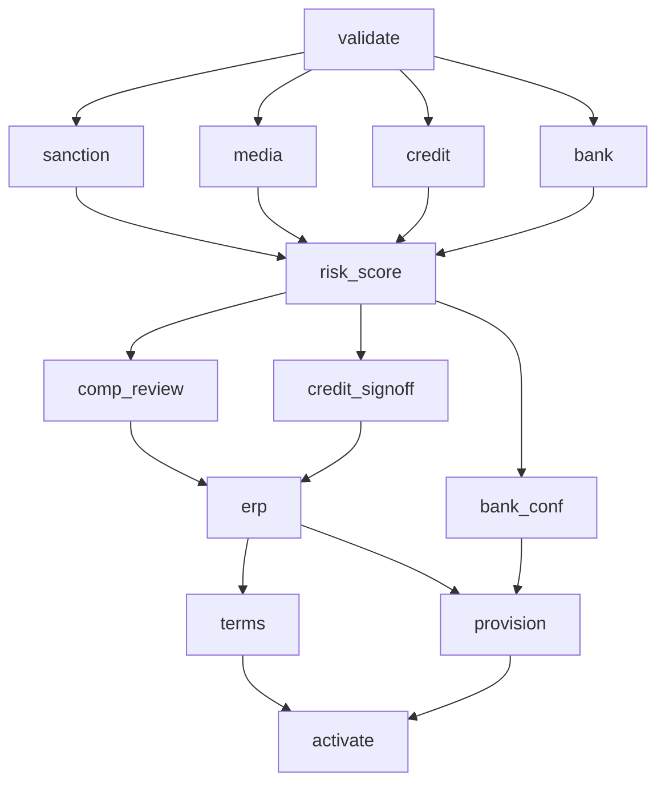
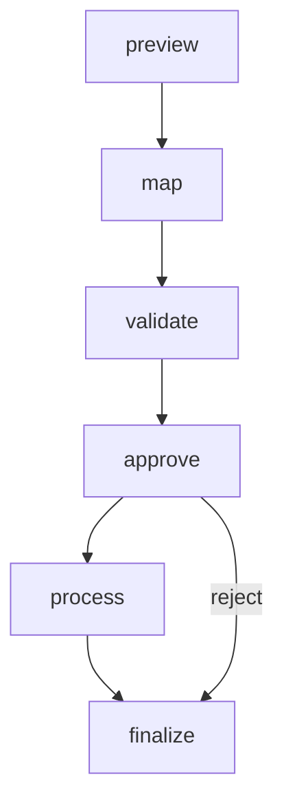
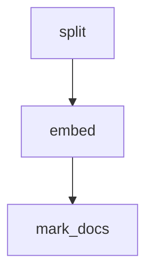
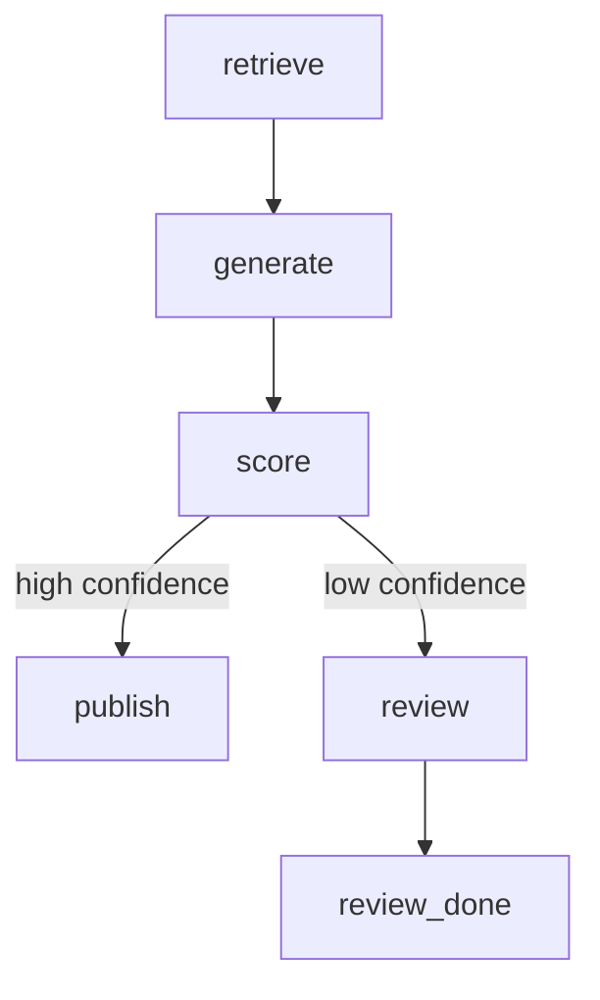

# Demo README workflows, roles, and RAG helpdesk content

Date: 2026-11-20

## Status

Active — ready for implementation approval.

## Outcome

Every runnable demo README explains, in reader-facing terms:

- what the demo does;
- its workflow/DAG, including human gates and branches;
- which actor/role performs each action;
- a copy-paste runbook;
- a short path a reader can follow to see the important behavior.

The RAG demo uses a friendly synthetic **employee helpdesk knowledge base**
so a reader can understand the retrieved answer without procurement-domain
knowledge. Its README explicitly explains that human review is an approval
step, not a reinforcement-learning or self-training loop.

## Evidence and current gaps

Verified from the repository:

- `examples/invoice_flow/README.md` already has a useful ASCII state-machine /
  triggered-workflow diagram, but actors are an inline sentence rather than a
  role table.
- `examples/supplier_onboarding/src/supplier_onboarding/registry.py:255-292`
  defines a substantial DAG: validate, four parallel checks, risk fan-in,
  conditional human reviews, provisioning branches, and activation. Its
  README has actors and paths but no workflow diagram.
- `examples/bulk_import/src/bulk_import/registry.py:232-250` defines
  `preview -> map -> validate -> approve -> process -> finalize`. Its README
  explains the story and actors but has no DAG diagram.
- `examples/rag_demo/src/rag_demo/registry.py:353-382` defines separate
  `rag.index@v1` and `rag.answer@v1` workflows. Answering is
  `retrieve -> generate -> score`, then either `publish` or
  `human.review -> review_done`; the review result is persisted for the
  question and does not modify the knowledge base or model.
- `examples/rag_demo/src/rag_demo/seed.py` currently contains 16 procurement
  documents and inserts them without clearing existing demo documents.
- `examples/rag_demo/tests/test_rag.py:175-186` uses a procurement question
  as its happy-path retrieval assertion; other tests use `payment terms?`.
- `examples/rag_demo/src/rag_demo/registry.py:64-75` uses a deterministic
  local hash embedding and cosine scan, not pgvector. The README must not
  imply model training, vector-database infrastructure, or production answer
  quality.
- Exa research on README guidance (mdkit's GitHub README guide and
  freeCodeCamp's README structure guide) supports the chosen sections:
  one-line purpose, demo/workflow visual, quick start, features, roles,
  usage/demo path, configuration/constraints, and tests.

## Product decisions

1. **RAG scenario:** employee helpdesk KB.
   Synthetic topics include password reset, VPN, laptop requests, leave,
   sick leave, working from home, health insurance, payroll, expenses,
   office access, cafeteria, parking, security, onboarding, and meeting
   rooms.
2. **RAG pipeline meaning:**
   - indexing: explicit document seed/index operation;
   - answering: retrieve top-k context, generate a deterministic answer,
     score confidence, then publish or require human review;
   - no reinforcement/self-training loop. Human review changes the question
     outcome only; it does not feed back into embeddings, prompts, model
     weights, or source documents.
3. **README diagram format:** use Mermaid `flowchart TD` for the new supplier,
   bulk, and RAG diagrams. Keep invoice_flow's existing ASCII diagram because
   it communicates its state-machine + triggered-workflow semantics more
   clearly and avoids duplicating that large diagram. Add a consistent roles
   table to invoice_flow.
4. **Seed safety:** add an explicit reset path for the demo seed rather than
   silently deleting data on every normal invocation. The documented content
   migration command will use the explicit reset option. No destructive reset
   is run against a database during implementation without operator approval.
5. **Scope:** documentation and demo-content alignment only. No change to
   keelflow engine semantics, pgvector integration, real LLMs, authentication,
   or UI localization behavior.

## Scope

In scope:

- `examples/supplier_onboarding/README.md`: workflow Mermaid diagram and
  role-to-step explanation.
- `examples/bulk_import/README.md`: workflow Mermaid diagram, including the
  reject/skip branch and the fact that validate/process fan out into chunks.
- `examples/rag_demo/README.md`: employee-helpdesk purpose, two workflow
  diagrams, actors, 60-second walkthrough, chaos knobs, no-reinforcement
  explanation, deterministic/no-pgvector constraints, and reset/reseed
  instructions.
- `examples/invoice_flow/README.md`: actors/roles table and a concise
  reader-facing demo path while preserving the existing ASCII workflow.
- RAG content and labels: `examples/rag_demo/src/rag_demo/seed.py`,
  `registry.py`, `app.py`, `pyproject.toml`, `schema.sql`,
  `templates/base.html`, and `templates/home.html`.
- RAG content-focused tests in `examples/rag_demo/tests/test_rag.py` and a
  focused seed/content check if needed.
- Root `README.md` demo description only if needed to keep the demo label
  consistent with the new employee-helpdesk scenario.

Out of scope:

- pgvector, ANN indexes, real embedding services, real LLM APIs, model
  fine-tuning, or reinforcement learning;
- changes to workflow execution or human-review semantics;
- adding a feedback-learning database model;
- redesigning the demo UIs;
- fixing unrelated engine/bulk-retention failures unless a touched RAG/demo
  contract directly causes them;
- commit, push, or CI configuration changes. Those require a separate
  approved implementation/ship step.

## Approach

### T1 — Confirm and document the demo contracts

Before edits, use the existing registry definitions as the source of truth.
Create concise diagrams with stable IDs and plain labels:

Supplier:



The README must annotate the conditional edges in prose because Mermaid
labels containing expression syntax are harder to scan: low risk takes
`bank_conf`; non-low risk takes `comp_review`; high risk also takes
`credit_signoff`; skipped branches satisfy `needs`.

Bulk:



Annotate `validate` and `process` as bulk parent steps with chunk fan-out and
fan-in; on rejection `process` is skipped and `finalize` records the abort.

RAG:





The RAG README must state that indexing and answering are separate workflows,
that retrieval is deterministic hash/cosine over local demo data, and that
human review is a quality gate with no learning feedback loop.

### T2 — Replace RAG fixture content with employee helpdesk KB

Replace the 16 seeded procurement docs with 16 short, synthetic helpdesk
articles. Ensure titles and bodies contain the vocabulary used by the sample
questions so the deterministic bag-of-words hash embedder retrieves the
intended chunks.

Update all user-facing and code-facing procurement labels that belong to this
demo: package description, schema/registry/app docstrings and titles, base
header/title, home placeholder, README examples, and test questions/assertions.
Do not translate or rename stable workflow/job IDs, actor IDs, permission
names, setting keys, or database table names.

Add an explicit `--reset` seed option (or equivalent clearly named CLI
contract) that clears only demo-owned RAG tables in dependency-safe order
before inserting the current 16 docs. Normal seed behavior must not silently
wipe questions or documents. Document the reset command for users with an
old local procurement database.

### T3 — Align tests and verify deterministic retrieval

Change the happy-path test to a helpdesk question such as:
`How do I reset my password?` and assert the generated answer contains the
expected helpdesk concept. Replace remaining procurement-only test prompts
with helpdesk prompts while preserving the purpose of flaky LLM, timeout/DLQ,
and human-review tests.

Run an actual indexing + answer path against Postgres and inspect the
retrieved chunk/source title. If the hash embedding ranks an unintended
article, adjust only the synthetic wording or sample question; do not add
special-case retrieval logic.

### T4 — README roles and demo scripts

For each README, use a consistent reader path:

- purpose and workflow visual;
- actors/roles table with IDs and allowed actions;
- run commands and port;
- 60-second or three-path demo script;
- constraints and tests.

Supplier role mapping must name `u-proc1`, `u-comp1`, `u-fin1`, `u-procadm`,
and `u-mgr`, and identify which human nodes each role handles. Invoice must
turn its existing actor sentence into a table. Bulk and RAG must retain their
existing actor IDs and clarify their human-task boundaries.

### T5 — Documentation and validation integration

Check that README statements match the registry and route behavior. Run
focused RAG tests, all demo tests, Markdown/diagram sanity checks available in
the repository, `git diff --check`, and the repository's required lint/type/
test commands. Record the pre-existing bulk-retention test failures
separately if they remain; do not hide them by weakening tests.

## Risks and recovery

- **Hash retrieval mismatch — medium:** deterministic toy embeddings can rank
  the wrong article. Mitigation: verify the actual top result and tune only
  fixture wording. Recovery: revert the fixture/content commit without engine
  migration.
- **Stale local procurement rows — medium:** seed currently appends. Mitigation:
  explicit reset command and a test for reset behavior. Do not run reset
  automatically against a shared database.
- **README Mermaid rendering — low:** unsupported punctuation or overly dense
  labels can render poorly. Mitigation: simple node IDs, plain labels, and
  source inspection/render check before completion.
- **Content-label drift — low:** old procurement text may remain in metadata,
  templates, tests, or README. Mitigation: repository search for old terms and
  a focused content check.
- **Baseline CI — high for shipping, not for README scope:** the working tree
  currently has known failures from the earlier bulk-retention work. Capture
  baseline output before this implementation and report whether any failure is
  pre-existing or introduced.

Recovery:

- Do not revert unrelated working-tree changes.
- If the RAG content migration is rejected, revert only the explicitly owned
  RAG content files and keep existing engine/demo changes intact.
- Do not delete database data as part of code implementation; use the explicit
  reset command only after confirmation on the target local database.

## Task graph

```text
T1 README contracts and diagrams
        ├──────────────┐
        ↓              ↓
T2 RAG fixture/content  T4 Roles and demo scripts
        ↓              ↑
T3 Retrieval/tests ─────┘
        ↓
T5 Integrated validation
```

T1 and T4 can be edited in parallel only if ownership is split by README;
T2 and T3 are sequential because tests depend on the new content. T5 is the
single integration owner.

## Acceptance evidence

- Each of the four demo READMEs has a clearly visible workflow and actors/
  roles section.
- Supplier README shows fan-out, risk fan-in, conditional HITL, provisioning
  join, and activation.
- Bulk README shows the human map/approve gates and reject path, and explains
  chunk fan-out/fan-in.
- RAG README shows both index and answer workflows and explicitly says there
  is no reinforcement/self-training loop.
- Invoice README has a role table matching the actor map and its existing
  state-machine/trigger workflow remains accurate.
- A fresh RAG seed creates 16 employee-helpdesk documents; an explicit reset
  removes stale demo content before reseeding; normal seed does not silently
  erase question history.
- The sample password-reset question retrieves the Password reset article in
  the real indexed path and produces an answer containing the expected
  concept.
- Flaky LLM, timeout/DLQ, weak retrieval/human review, and bulk embed chaos
  paths retain their original behavior and tests.
- Search finds no stale procurement-specific RAG labels in the owned demo
  metadata, UI, README, or tests.

## Validation

Focused:

```bash
uv run pytest examples/rag_demo/tests -q
uv run pytest examples/invoice_flow/tests examples/supplier_onboarding/tests \
  examples/bulk_import/tests -q
```

Content/runtime smoke check, against an isolated local demo database:

```bash
uv run --package keelflow-demo-rag python -m rag_demo.seed --reset
uv run --package keelflow-demo-rag python -m rag_demo.seed
# start the documented RAG worker/UI and ask the password-reset question;
# inspect /q/<id> and confirm the retrieved source is Password reset
```

Repository checks:

```bash
uv run pytest -q
uv run ruff check src examples tests
uv run mypy src/keelflow
git diff --check
```

The current repository baseline has known failures from the earlier bulk
retention implementation (`test_bulk_partitions_and_applies`,
`examples/bulk_import/tests/test_import.py::test_full_import_approve`, and
`tests/test_e2e.py::test_e2e_scenario`). Implementation must report whether
those are fixed separately or remain; it must not claim a green suite without
proof.

## Progress

- [x] Read repository rules and current demo workflow definitions.
- [x] Research README structure with Exa.
- [x] Select employee helpdesk KB content and Mermaid approach for new diagrams.
- [x] Record RAG no-reinforcement-loop contract.
- [x] T1 — Add README workflow diagrams and role explanations.
- [x] T2 — Complete RAG helpdesk content and explicit reset contract.
- [x] T3 — Align RAG tests and verify actual retrieval.
- [x] T4 — Align all README demo scripts and actor tables.
- [x] T5 — Run validation and report baseline/new failures.

## Approval gate

Implementation must not start until the user explicitly approves this plan.

## Result

Completed 2026-11-20:

- All 4 READMEs now show the workflow + actors/roles. Supplier and bulk
  got Mermaid DAGs; RAG got both index and answer Mermaid DAGs plus an
  explicit "no reinforcement loop" note; invoice_flow kept its ASCII
  SM/trigger diagram and gained an actors table + 60-second demo path.
- RAG content replaced with a 16-doc employee-helpdesk KB (seed.py),
  labels updated across pyproject/schema/registry/app/templates/README.
- `seed --reset` clears only demo-owned RAG tables; plain seed appends.
- Tests updated; the password-reset question retrieves the Password
  reset article and answers contain "password" (real path verified).
- Root README demo blurb updated to "employee helpdesk RAG".
- **Bonus fix while validating:** a real `_fan_in` race was found — two
  chunks settling near-simultaneously could both compute the summary;
  the second overwrote with `archived_rows=0` after the first moved
  rows. Fixed by locking the parent job row `FOR UPDATE` before the
  summary/cleanup — later fan-ins see the terminal status and return.
  This removed the `test_bulk_partitions_and_applies` flake and the
  `test_e2e`/`test_import_approve` failures.
- Validation: `uv run pytest -q` → **110 passed**; `uv run ruff check
  src examples tests` clean; `uv run mypy src/keelflow` clean;
  `git diff --check` clean.
